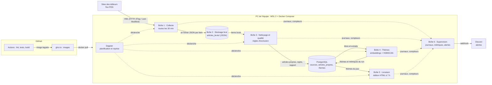

# Note de cadrage - La gazette

## 1. Le besoin

Chaque matin, on veut savoir de quoi parle la presse quotidienne française, régionale (PQR) et nationale (PQN). Le pipeline lit ce que les journaux publient dans leurs flux RSS, écarte ce qui n'a rien à faire dans une gazette (horoscope, jeux, publi-reportages...), regroupe les articles restants par thèmes et publie à 7 h une édition : pour chaque thème, les titres, les sources et les liens vers les articles.

Le projet est évalué sur l'exploitation plus que sur les fonctionnalités : le pipeline doit tourner seul, être testé, surveillé, reproductible et documenté.

## 2. Périmètre et contraintes

| Dans le périmètre | Hors périmètre |
|---|---|
| Lecture des flux RSS ou Atom publiés par les éditeurs | Scraping des pages d'articles |
| Titre, extrait court, lien, date, rubrique, source | Texte intégral, images, commentaires, noms des auteurs |
| Nettoyage, règles d'exclusion, rapport de qualité | Résumés générés par un LLM |
| Regroupement par thèmes, évalué et versionné | Front travaillé, personnalisation par lecteur |
| Édition HTML quotidienne, archivée | Comptes utilisateurs, abonnés, suivi d'audience |
| CI/CD, conteneurs, orchestration, supervision | Services ou API payants |

| Contrainte | Valeur | Comment on la tient |
|---|---|---|
| Heure de parution | 7 h chaque jour | Planification dans l'orchestrateur, heure de parution mesurée (TD 7-8) |
| Fraîcheur | articles de moins de 24 h | Date de publication contrôlée au nettoyage, collecte toutes les 30 min |
| Conditions des éditeurs | robots.txt et CGU respectés | Vérifiés pour chaque source dans `sources.csv`, flux interdits écartés |
| Politesse | User-Agent identifiable, ETag / Last-Modified, 30 min minimum, une requête à la fois par éditeur | Codé dans le collecteur (TD 3) |
| Données personnelles | aucune | On ne garde ni auteurs, ni commentaires, ni profils |
| Budget | zéro | Outils libres, machines de l'équipe, infrastructure fournie plus tard (TD 4 ou 6) |

## 3. Les sources

Vérification faite à la main avec curl le 12/11/2026 : réponse 200 en XML, format, en-têtes ETag et Last-Modified, robots.txt (règles lues selon la RFC 9309, jokers compris), CGU, fréquence estimée à partir des dates des items. Le détail est dans `sources.csv`.

| Retenues | PQR | PQN |
|---|---|---|
| Titres | La Dépêche du Midi, Le Progrès, Nice-Matin, L'Est Républicain, La Provence | Le Monde, Libération, Le Figaro, La Croix, 20 Minutes |
| Format | RSS 2.0 pour toutes | RSS 2.0 pour toutes |
| ETag ou Last-Modified | La Provence | Libération, La Croix, 20 Minutes |

| Écartée | Type | Raison |
|---|---|---|
| Ouest-France | PQR | robots.txt : `Disallow: /` pour tout robot autre que les moteurs de recherche listés |
| La Voix du Nord | PQR | Flux refusé (403 renvoyé par la protection anti-robot) |
| Le Télégramme | PQR | Flux refusé (403 renvoyé par la protection anti-robot) |
| Sud Ouest | PQR | Flux derrière un défi JavaScript anti-robot (boucle de redirections puis 403) |
| Les Échos | PQN | Flux cassé : 503 à deux essais espacés |
| L'Humanité | PQN | robots.txt : `Disallow: */feed`, le flux est interdit |
| Le Parisien | PQN | Items sans date ni extrait : fraîcheur impossible à contrôler |

En réserve, flux vérifiés et autorisés par robots.txt : Le Dauphiné Libéré, Midi Libre (PQR), L'Opinion (PQN).

Point d'attention : toutes les sources retenues limitent l'usage de leurs contenus à un usage privé, et sept d'entre elles déclarent s'opposer à la fouille de textes et de données (article L122-5-3 III du Code de la propriété intellectuelle). Voir le risque R1.

## 4. Veille

| Sujet | Option A | Option B | Limites | Recommandation |
|---|---|---|---|---|
| Récupérer la presse | Flux RSS / Atom des éditeurs | Scraping des pages HTML | RSS : flux courts (10 à 100 items), formats et dates variables, certains flux bloqués. Scraping : interdit par la plupart des CGU, fragile, hors bornage | RSS, lu avec un parseur éprouvé, en-têtes conditionnels |
| Faire tourner chaque matin | cron sur la machine | Orchestrateur (Dagster, Airflow) | cron : pas d'historique, pas de reprise, pas de dépendances entre étapes. Orchestrateur : un service de plus à faire tourner | Orchestrateur décrit en code (Dagster) |
| Stocker le brut et le propre | Fichiers JSON (brut) + base relationnelle (propre) | Tout en base (JSONB) ou stockage objet (MinIO) | Fichiers : pas de requêtes, à purger. Tout en base : le brut et le propre se mélangent. MinIO : un service de plus pour peu de volume | JSON pour le brut, PostgreSQL pour le propre |
| Regrouper par thèmes | TF-IDF + KMeans | Embeddings (sentence-transformers) + HDBSCAN | TF-IDF : sensible au vocabulaire, nombre de thèmes fixé à l'avance. Embeddings : modèle à télécharger, calcul plus long | Embeddings + HDBSCAN, qui trouve le nombre de thèmes et met le bruit à part |
| Surveiller un pipeline | Journaux + alertes Discord seulement | Métriques Prometheus + tableau de bord Grafana | Journaux seuls : pas de courbes dans le temps. Prometheus/Grafana : deux services à configurer | Les deux : journaux structurés et alertes dès le TD 3, métriques au TD 8 |
| Décrire l'infrastructure en code | Docker Compose | Terraform ou Ansible | Compose : une seule machine. Terraform/Ansible : utiles quand l'infrastructure de production sera connue | Compose dès le TD 2, choix pour la production quand l'infrastructure sera fournie |

## 5. Stack retenue

| Besoin | Outil retenu | Alternatives écartées et pourquoi |
|---|---|---|
| Langage | Python 3.12 | Go : bon pour un collecteur, mais pas d'écosystème pour les embeddings. Node.js : même limite côté ML |
| Dépendances | uv | Poetry : plus lent, plus de configuration. pip + venv : pas de fichier de verrouillage natif, environnement moins reproductible |
| Lecture des flux | feedparser | Parseur maison (ElementTree) : on devrait gérer soi-même RSS, Atom, encodages et formats de date. atoma : moins tolérant aux flux mal formés |
| Client HTTP | httpx | requests : pas de timeout par défaut, pas de transport de test intégré. urllib : bas niveau, en-têtes conditionnels plus verbeux |
| Stockage brut | Fichiers JSON | JSONB dans PostgreSQL : on ne garderait plus le brut à part du propre. MinIO : un service de plus pour quelques Mo par jour |
| Stockage propre | PostgreSQL | SQLite : un seul écrivain, gênant avec l'orchestrateur et la collecte en parallèle. DuckDB : orienté analyse, mono-processus en écriture |
| Migrations | Alembic | Scripts SQL à la main : pas de suivi de la version appliquée. Flyway : outil Java, une stack de plus |
| Accès à la base (TD 3) | SQLAlchemy 2.0 (requêtes SQL écrites avec `text()`) et le pilote psycopg | ORM complet : plus de code et de concepts pour quelques requêtes simples. Pilote seul sans SQLAlchemy : Alembic et Dagster en dépendent déjà, autant s'en servir pour la connexion. SQLAlchemy est limité à 2.0 car la 2.1 passe à psycopg 3 par défaut, que le stockage Postgres de Dagster ne supporte pas encore |
| Orchestration | Dagster (webserver + daemon, historique dans une base PostgreSQL séparée) | Airflow : plus lourd (scheduler, webserver, workers, triggerer), pensé en tâches plutôt qu'en données. cron : ni historique, ni reprise, ni contrôles de qualité. Dagster raisonne en assets (`articles_bruts`, `articles_propres`), garde les métadonnées de chaque passage et offre les asset checks pour les contrôles de qualité du TD 4 |
| Tests | pytest | unittest : plus verbeux, fixtures moins pratiques. Tests manuels : non rejouables en CI |
| Lint | ruff | flake8 + black : deux outils plus lents à configurer ensemble. pylint : lent et bavard pour un petit projet |
| Conteneurs | Docker, Docker Compose | Podman : compatible mais moins documenté sous Windows/WSL. Kubernetes local (kind) : trop lourd pour une seule machine |
| CI | GitHub Actions | GitLab CI : le dépôt est sur GitHub. Jenkins : un serveur de plus à maintenir |
| Registre d'images | ghcr.io | Docker Hub : limites de téléchargement et un compte de plus. Registre auto-hébergé : un service à maintenir |
| Alertes | Webhook Discord | E-mail SMTP : besoin d'un serveur ou d'un compte, risque de spam. Slack : historique limité sur l'offre gratuite |
| Thèmes (TD 5) | sentence-transformers, HDBSCAN | TF-IDF + KMeans : voir veille. BERTopic : plus de dépendances, plus difficile à expliquer ligne par ligne |
| Suivi des modèles (TD 5) | MLflow | Weights & Biases : service hébergé avec compte. DVC : versionne bien les données mais pas de registre de modèles simple |
| Monitoring (TD 8) | Prometheus, Grafana | Uptime Kuma : dit si un service répond, pas plus. Loki seul : journaux sans métriques |

## 6. Risques

| N° | Risque | Impact | Ce qu'on fait |
|---|---|---|---|
| R1 | Les CGU des éditeurs réservent leurs contenus à un usage privé et s'opposent souvent à la fouille de textes | Fort : base légale de la collecte | Usage pédagogique non commercial, lecture des seuls flux mis à disposition, titre + extrait + lien seulement, édition à diffusion restreinte, question posée à l'enseignant, retrait immédiat d'une source sur demande de l'éditeur |
| R2 | Une source bloque les robots ou change d'adresse (déjà 4 PQR sur 7 perdues) | Moyen | 5 PQR et 5 PQN, sources en réserve, mise en sommeil automatique et alerte (TD 3) |
| R3 | Flux sans ETag ni Last-Modified (6 sur 10) | Faible | Collecte toutes les 30 min au plus, flux de quelques dizaines de Ko |
| R4 | Flux à fenêtre courte (La Provence : 20 items pour environ 2 h) | Moyen : items perdus si la collecte s'arrête | Collecte toutes les 30 min, alerte si une source n'a pas réussi depuis longtemps |
| R5 | Données personnelles dans les flux (champ dc:creator) | Moyen | Champ non repris dans la table propre ni dans l'édition |
| R6 | Le pipeline tourne sur un PC personnel (veille, coupure, réseau) | Fort jusqu'à la mise en production | `restart: unless-stopped`, reprise par l'orchestrateur, alertes, migration sur l'infrastructure fournie |
| R7 | Dates et encodages hétérogènes (dates ISO 8601 dans un flux RSS 2.0 chez La Provence) | Moyen | feedparser, dates stockées en UTC, contrôle de fraîcheur au nettoyage |
| R8 | Deux sources sur la même plateforme (groupe EBRA) | Faible | Une panne commune reste visible par la mise en sommeil, sources en réserve d'autres groupes |
| R9 | Thèmes peu lisibles | Moyen | Métriques et échantillon relu à chaque run (TD 5-6) |

## 7. Rôles dans l'équipe

| Membre | Rôle principal | Sujets suivis |
|---|---|---|
| A compléter | | |
| A compléter | | |

## 8. Architecture

Tout tourne en conteneurs sur un PC de l'équipe (Windows 11, WSL 2, Docker Compose) jusqu'à la mise à disposition de l'infrastructure de production (TD 4 ou 6). La CI et le registre d'images sont chez GitHub.

